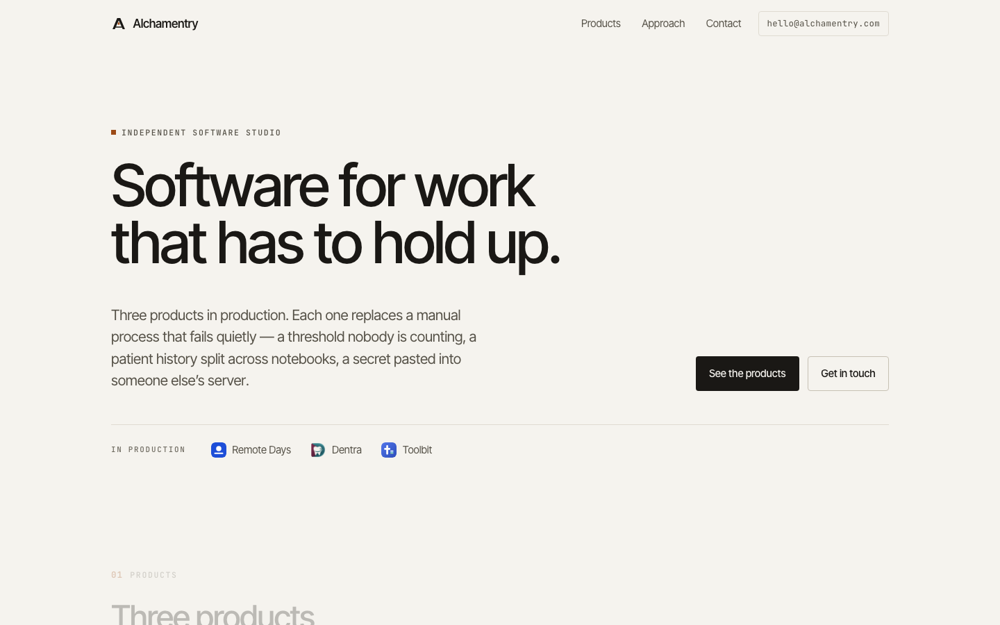

# alchamentry-web

The homepage for **[alchamentry.com](https://alchamentry.com)** — the studio behind
three products in production:

| Product | Live at | What it is |
| --- | --- | --- |
| Remote Days | [remotedays.app](https://remotedays.app) | Cross-border remote work compliance |
| Dentra | [dentra.fly.dev](https://dentra.fly.dev) | Practice management for dental clinics |
| Toolbit | [toolbit.app](https://toolbit.app) | A local-first developer toolbox |



---

## The design is supplied, not built here

The homepage design is the **showcase** in
[`design/alchamentry-site-showcase.html`](design/alchamentry-site-showcase.html),
with its brand assets in [`src/assets/brand/`](src/assets/brand/). That showcase is
the design of record.

The shipped page is that design, converted so it can be deployed: the two embedded
base64 marks became references to the same SVG files, the inline `<style>` and
`<script>` became external files, and the Google Fonts link became self-hosted
`@font-face`. **Nothing visual changed** — the two renderings differ by 0.036 % of
pixels, all of it the hero flask's float animation.

[**DESIGN.md**](DESIGN.md) describes the system as shipped — palette, type, layout,
components, the mark, and exactly what the conversion changed and why. Read it before
changing anything visual.

## How it is put together

No framework, no bundler, no runtime dependencies. `src/` is the site; `dist/` is what
gets deployed. The build copies one to the other, renames `site.css` and `site.js` to
`site.<hash>.css` / `site.<hash>.js` and rewrites every reference, then swaps in three
tokens (`{{YEAR}}`, `{{BUILD}}`, `{{BUILD_DATE}}`).

```
src/
  index.html              the page
  404.html                served by Pages for anything not found
  _headers                CSP and cache policy — Cloudflare Pages reads this
  robots.txt  sitemap.xml  site.webmanifest
  og.png  favicon.svg  favicon.ico  icon-*.png  apple-touch-icon.png
  assets/
    brand/                the supplied marks — design of record, never edited
    css/site.css          generated from the showcase, then edited by hand
    js/site.js            generated from the showcase
  fonts/                  Inter (variable) + DM Mono, self-hosted, woff2
scripts/
  build.mjs               src/ -> dist/, with content hashing
  import-showcase.mjs     design/ -> src/  (one-shot, see below)
  icons.mjs               brand icon -> favicon and app-icon plates
  serve.mjs               tiny static server for local check
design/
  alchamentry-site-showcase.html   the supplied design, not deployed
```

Everything the page needs is same-origin — no CDN, no analytics, no third-party
requests, no cookies. The `_headers` file ships a strict Content-Security-Policy that
allows exactly that.

### Why the CSS and JS are hashed

Cloudflare Pages applies its own 4-hour `Cache-Control` to recognised asset
extensions, and that `max-age` beats anything set in `_headers`. A 4-hour cache is
only safe on a URL that changes when the file does, so the build puts a content hash
in the filename. `_headers` documents the rest of the policy, including the one
genuinely surprising rule: never set the same header in two overlapping `_headers`
blocks, because Pages joins the values rather than choosing one.

## Local development

```sh
npm run dev        # build, then serve http://localhost:4173
```

`npm run build` writes `dist/`. `npm run serve` serves an existing `dist/`. There is
nothing to install to build the site.

## Deployment

Production is a **Cloudflare Pages** project called `alchamentry`, with
`alchamentry.com` and `alchamentry.pages.dev` attached to its `main` branch. The
project is a Direct Upload project; it is not connected to Git on Cloudflare's side.
GitHub Actions is the only deployment path.

`.github/workflows/deploy.yml`:

- **push to `main`** → builds and deploys to production
- **pull request** → builds and deploys a preview to that branch, then comments the URL
- **workflow_dispatch** → same as a push to `main`

Preview deployments on `*.alchamentry.pages.dev` are covered by a Cloudflare Access
policy on the account, so preview URLs ask for a login before they render. That is the
existing project setting, not something this repo adds. Production is public.

### Required repository secret

| Secret | Status |
| --- | --- |
| `CLOUDFLARE_ACCOUNT_ID` | set — `7eab50fe896772eef60711eca3392763` |
| `CLOUDFLARE_API_TOKEN` | **not set.** Create it at [dash.cloudflare.com/profile/api-tokens](https://dash.cloudflare.com/profile/api-tokens) → Create Token → Create Custom Token → permission **Account · Cloudflare Pages · Edit**, then: |

```sh
gh secret set CLOUDFLARE_API_TOKEN --repo alwin-augustin/alchamentry-web
```

Until that is set, the deploy job fails fast with a message saying so. `npm run deploy`
works locally without it, using your own `wrangler login`.

## Editing

- **Copy, markup and most styling** are in `src/index.html` and
  `src/assets/css/site.css`.
- **Do not run `npm run import-showcase`** after editing those by hand — it
  regenerates them from `design/alchamentry-site-showcase.html` and will overwrite
  your work. It exists to document how the showcase became the site, not as a step in
  the build.
- **Colour, type and spacing** are CSS custom properties at the top of
  `src/assets/css/site.css`. Change them there, not at the point of use.
- **Product facts** are the one thing most likely to go stale. Check them against the
  products themselves.

### Icons

`src/assets/brand/alchamentry-icon.svg` is never edited. The plate variants are
generated from it:

```sh
npm run icons      # rewrites src/favicon.svg and src/assets/brand/alchamentry-plate-bleed.svg
```

The raster exports are committed and nothing generates them automatically. After
changing a plate, re-export:

- `favicon.ico` (16/32/48), `icon-192.png`, `icon-512.png` — from `src/favicon.svg`
- `apple-touch-icon.png`, `icon-maskable-512.png` — from `alchamentry-plate-bleed.svg`
- `og.png` — 1200×630 share card

## Known issues

**Eleven small text styles fail WCAG AA contrast (2.86–4.47:1).** They are all 8–11 px
mono labels using `--muted #7C899C` on light surfaces. The full list is in
[DESIGN.md §2](DESIGN.md). One token change fixes every one of them:

```css
/* src/assets/css/site.css */
--muted: #66748A;   /* 4.53:1 on --paper */
```

It is not applied, because darkening the metadata greys is a visible design decision
and the design was supplied as final. Applying it costs nothing structurally — say the
word and it is a one-line change plus a rebuild.

Everything else checks out: heading order is sequential, landmarks are present, every
image has appropriate alt text, there are no empty links, and the page has no console
errors.
